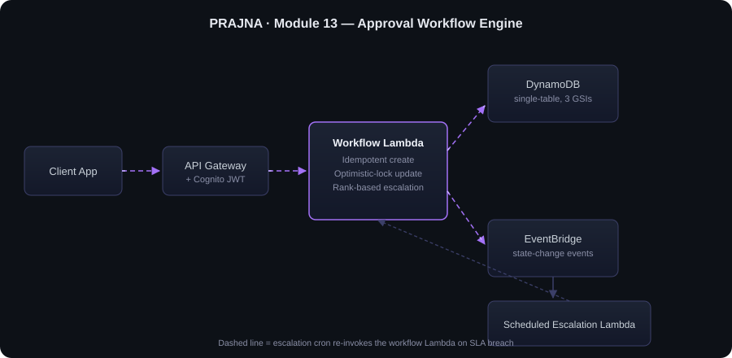

<div align="center">



<br/>
<br/>

[](https://github.com/DenverCoder1/readme-typing-svg)

<br/>

<a href="https://maczeo.me"></a>
<a href="https://github.com/maczeo11"></a>
<a href="https://www.linkedin.com/in/bhanu-teja-komma-4b5547293/"></a>
<a href="mailto:bhanu0005a@gmail.com"></a>
<a href="https://leetcode.com/u/GB2023002633/"></a>

</div>

<br/>

## About

```yaml
name:      Bhanu Teja Komma
role:      Backend Engineer — Cloud-Native / Distributed Systems
focus:     TypeScript, Go, Python, AWS (Lambda, DynamoDB, EventBridge, CDK), Express, Postgres, MongoDB, Kafka, Redis
rust:      Rust for personal CLI tools (cargo) — systems-leaning, no production claim
azure:     Working knowledge — VMs/VMSS, Functions, Container Apps, VNet/Subnets, Blob Storage, Azure SQL, Entra ID
exploring: gRPC, Spring Boot
location:  Bengaluru, India
portfolio: https://maczeo.me
openTo:    Backend / Cloud-Native / Platform roles
currently: Building event-driven platforms on AWS + Postgres/Kafka/Redis
```

I'm a final-year B.Tech CSE student at GITAM. I build backend systems where the interesting part isn't the CRUD — it's what happens when two requests race each other. Most of my time lives inside **AWS** (Lambda, DynamoDB, EventBridge, CDK, Step Functions), **Kafka** for event streaming, and **Postgres/Redis** for data — thinking through idempotency, optimistic locking, single-table design, and event-driven workflows instead of bolting them on after something breaks in production.

Recent focus areas:
- **Approval Workflow Engine (PRAJNA, Module 13)** — Led the Business Logic layer (Modules 13–18) and built the multi-stage approval engine itself: optimistic concurrency control on DynamoDB and EventBridge event routing.
- **Event-Driven Services (CineFund)** — Transactional outbox on PostgreSQL polled via `FOR UPDATE SKIP LOCKED` → Kafka, paired with Redis `SETNX` dual-layer payment idempotency.
- **Microservices & Tooling** — Modular document extraction pipelines, Redis caching layers, and Infrastructure-as-Code with AWS CDK.

<br/>

## Tech Stack

| Category | Technologies & Tools |
|---|---|
| **Core Languages** |  |
| **Backend & Data** |  |
| **Frontend** |  |
| **Infra & DevOps** |  |
| **Exploring** |  |

<br/>

### AWS & Cloud-Native Services

<p align="center">


</p>

### Azure & Cloud Services <sub>working knowledge</sub>

<p align="center">


</p>

<p align="center"><sub>Comfortable provisioning &amp; operating — VMs/autoscaling, VNet/subnet design, serverless Functions, Container Apps, Blob Storage, managed databases, and Entra ID identity. AWS remains my primary cloud.</sub></p>

<br/>

> **Open source by default.** If it's not a secret, it's public — issues, PRs, and docs welcome.

<br/>

## Linux & Distributed Systems Toolkit

<sub>2 years daily-driving Arch/CachyOS before a forgotten BIOS lock sent me to Windows + WSL2. The habits stuck.</sub>

<p align="center">


</p>

<p align="center"><sub>Kafka for event streaming, Redis for caching & idempotency, systemd/Docker/tmux/fzf/rg in the terminal.</sub></p>

<br/>

<div align="center">

</div>

<br/>

<div align="center">

</div>

<br/>

## What I Think About

<details>
<summary><b>7 distributed systems principles I apply day-to-day</b> — click to expand</summary>
<br/>

| Principle | Core Engineering Practice |
|---|---|
| **Idempotency** | Designing writes so a Lambda retry or webhook burst can't double-create or double-charge anything. |
| **Optimistic Locking** | Version-checked conditional writes so two approvers racing the same record don't silently clobber each other. |
| **Single-Table Design** | Modeling access patterns first, then collapsing entities into one DynamoDB table with GSIs instead of multi-table joins. |
| **Event-Driven Workflows** | EventBridge as the backbone for state changes, instead of services polling each other for status. |
| **Multi-Tenant Isolation** | Scoping every query by role and campus at the auth layer, not trusting the client to ask nicely. |
| **Policy as Data** | Encoding business rules as a registry the code interprets, so a policy change is a data edit and the API contract stays unified. |
| **Explainable State** | Keeping an append-only record of *why* a number is what it is — a running balance can't answer audit questions six months later. |

</details>

<br/>

<div align="center">

</div>

<br/>

## Featured Work

### PRAJNA — Approval Workflow Engine

<p>


</p>

**Module 13 of PRAJNA — a 24-module AWS platform built by a team at GITAM.** I led the Business Logic layer (Modules 13–18) and personally built this engine and its shared contracts. It's a multi-stage approval engine for faculty submissions across campuses, built to maintain strict transactional consistency when multiple human approvers and an automated escalation timer act on the same submission simultaneously.

<div align="center">

</div>

<br/>

**The problem:** approvers escalate submissions up a rank ladder while a scheduled Lambda escalates overdue items past their SLA. If an approver acts at the exact moment the escalation cron fires, stale updates will clobber state without proper concurrency control.

**How it's handled:**
- **Optimistic Concurrency Control:** Atomic version checks on DynamoDB writes (`ConditionExpression: '#v = :expectedVersion'`), plus `TransactWriteItems` so a request, its lookup pointer, and its idempotency pointer commit atomically. A stale write throws a typed `ConflictError` instead of clobbering a concurrent approval.
- **Idempotent Workflow Creation:** A pending-entity guard returns the existing `requestId` when a workflow already exists for that `(module, entity, campus, faculty)`, and an atomic `TransactWrite` pointer prevents two concurrent retries from both inserting.
- **Escalation Ladder w/ Self-Loop Guard:** A rank-ordered escalation walker (Day 3 reminder → Day 7 Director → Day 10 PVC) that never escalates a step to itself or a lower rank.
- **Server-Side Campus Scoping:** Role and campus (`custom:role`, `custom:campus`) are read from Cognito JWT claims; a `role+campus` GSI drives pending-approval queries, so an approver never sees another campus's queue.

<details>
<summary><b>Architecture Deep Dive: Single-Table Access Pattern & Optimistic Lock (Module 13)</b></summary>
<br/>

```typescript
// PRAJNA Module 13 — single-table key layout
//   PK=CAMPUS#<campus>   SK=REQ#<requestId>          (tenant-scoped main item)
//   GSI1 PK=STATUS#<status>#ROLE#<role>  SK=CREATED_AT#<ts>      → role+campus pending queue
//   GSI2 PK=FACULTY#<facultyId>          SK=CREATED_AT#<ts>      → a faculty member's history
//   GSI3 PK=DEADLINE                     SK=STATUS#<status>#<deadline> → escalation cron scan
//   + a REQ#<id> pointer item for O(1) getById without knowing the campus
const mainItem = {
  PK: `CAMPUS#${request.campus}`,
  SK: `REQ#${request.requestId}`,
  GSI1PK: `STATUS#${request.overallStatus}#ROLE#${request.steps[request.currentStep].role}`,
  GSI2PK: `FACULTY#${request.facultyId}`,
  GSI3PK: 'DEADLINE',
  // ...flattened request fields, incl. `version`
};

// Optimistic lock on write — a concurrent approval loses the race, not the data
const expectedVersion = request.version ?? 1;
request.version = expectedVersion + 1;

await this.docClient.send(new PutCommand({
  TableName: this.tableName,
  Item: mainItem,
  ConditionExpression: '#v = :expectedVersion',
  ExpressionAttributeNames:  { '#v': 'version' },
  ExpressionAttributeValues: { ':expectedVersion': expectedVersion },
}));
// ConditionalCheckFailedException → typed ConflictError (409); caller re-reads and retries.
```

*Key Pattern:* Campus is the partition key (tenant isolation at the storage layer); role+status, faculty, and deadline each get a GSI, so no access pattern needs a table scan. Every write carries a `version` condition, so two approvers racing the same request can't silently overwrite each other.
</details>

<sub>Source-verified against the (private) `prajna-business-logic` repo — `DynamoDBClientAdapter.ts` (key layout, `TransactWrite`, version condition) and `ApprovalWorkflowEngine.ts` (idempotency guard, escalation ladder). Details in [proofs/prajna/](https://github.com/maczeo11/maczeo11/tree/main/proofs/prajna).</sub>

<br/>

<div align="center">

</div>

<br/>

### CineFund — Crowdfunding & Video Streaming

<p>


&nbsp; <b><a href="https://github.com/maczeo11/cinefund">Repository →</a></b>
</p>

An event-driven Go backend for crowdfunding independent short films — money path built before video with **PostgreSQL + Kafka + Redis**, inspired by MagicStream (movie streaming foundation with JWT/httpOnly-cookie auth and HTTP Range streaming).

<div align="center">

</div>

<br/>

**The problem:** payment providers send duplicate webhook bursts upon network retries, risking double-crediting if not deduplicated. Simultaneously, publishing Kafka events alongside database writes risks dual-write inconsistencies if the broker is unreachable midway.

**How it's handled:**
- **Transactional Outbox Pattern:** Domain records and outbox events commit together in a single ACID PostgreSQL transaction. A Go worker pool polls with `FOR UPDATE SKIP LOCKED` and publishes to Kafka without double-dispatch.
- **Dual-Layer Payment Idempotency:** Redis `SETNX` (24h TTL, `idem:wh:<eventID>`) acts as a sub-millisecond fast-path gate, backed by an authoritative PostgreSQL `UNIQUE(provider, provider_event_id)` constraint. Verified under 50 concurrent requests (1 success, 49 duplicate rejections).
- **Async Video Transcoding:** Kafka events trigger background FFmpeg workers over gRPC (Protobuf) to generate HLS segments with HTTP Range seeking.
- **Production Practices:** Token-bucket rate limiting, structured logging with `log/slog`, distributed trace IDs, and graceful shutdown.

<details>
<summary><b>Under the Hood: Transactional Outbox Schema & Concurrency Dispatcher (SQL)</b></summary>
<br/>

```sql
-- Outbox table: stores domain events atomically with business transactions
CREATE TABLE outbox (
    id             BIGINT GENERATED ALWAYS AS IDENTITY PRIMARY KEY,
    event_id       UUID NOT NULL UNIQUE,        -- dedupe key for Kafka consumers
    event_type     TEXT NOT NULL,               -- e.g. 'pledge.captured'
    event_version  INTEGER NOT NULL DEFAULT 1,
    aggregate_type TEXT NOT NULL,               -- e.g. 'pledge'
    aggregate_id   UUID NOT NULL,               -- Kafka partition key
    payload        JSONB NOT NULL,
    trace_id       TEXT,                        -- W3C distributed traceparent
    created_at     TIMESTAMPTZ NOT NULL DEFAULT now(),
    published_at   TIMESTAMPTZ,
    attempts       INTEGER NOT NULL DEFAULT 0,
    last_error     TEXT
);

-- Partial index scanning only unpublished events for high dispatcher throughput
CREATE INDEX idx_outbox_unpublished ON outbox (id) WHERE published_at IS NULL;

-- Dispatcher query: SKIP LOCKED allows multiple worker threads to pull batches without lock contention
SELECT id, payload 
FROM outbox 
WHERE published_at IS NULL 
ORDER BY id 
LIMIT 50 
FOR UPDATE SKIP LOCKED;
```

*Key Pattern:* `FOR UPDATE SKIP LOCKED` enables horizontal scaling of background Go dispatchers without rows being double-processed or causing transaction deadlocks.
</details>

<sub>Full proof artifacts: [proofs/cinefund/](https://github.com/maczeo11/maczeo11/tree/main/proofs/cinefund) — migration files, concurrent test output, ledger schema.</sub>

---

### Serverless Apartment Maintenance Portal

<p>


&nbsp; <b><a href="https://github.com/maczeo11/serverless-apartment-manager">Repository →</a></b>
</p>

A full-stack maintenance portal for campus residential blocks — built to explore single-table DynamoDB access pattern modeling and AWS CDK Infrastructure-as-Code prior to incorporating them into PRAJNA.

- **Automated SLA Tracking:** EventBridge cron rules fire every 15 minutes to evaluate overdue tickets against SLA deadlines.
- **Single-Table Access Modeling:** Efficiently queries requests by resident or status without relational joins.
- **Role-Based Access Control:** Cognito-authenticated admin and resident roles with scoped API permissions.
- **100% IaC:** Entire stack defined reproducibly in TypeScript via AWS CDK.

<details>
<summary><b>Architecture Deep Dive: Apartment Requests Schema (AWS CDK)</b></summary>
<br/>

```typescript
// Single-table DynamoDB construct with secondary indexes for apartment maintenance
const requestsTable = new dynamodb.Table(this, 'RequestsTable', {
  tableName: `maintenance-requests-${stage}`,
  partitionKey: { name: 'PK', type: dynamodb.AttributeType.STRING },
  sortKey:      { name: 'SK', type: dynamodb.AttributeType.STRING },
  billingMode:  dynamodb.BillingMode.PAY_PER_REQUEST,
  timeToLiveAttribute: 'ttl',
  removalPolicy: isProd ? cdk.RemovalPolicy.RETAIN : cdk.RemovalPolicy.DESTROY,
});

// GSI 1: Query all requests filed by a specific resident (PK=residentId, SK=createdAt)
requestsTable.addGlobalSecondaryIndex({
  indexName:    'ResidentIndex',
  partitionKey: { name: 'residentId', type: dynamodb.AttributeType.STRING },
  sortKey:      { name: 'createdAt',  type: dynamodb.AttributeType.STRING },
});

// GSI 2: SLA Escalation worker query (PK=status, SK=slaDeadline)
requestsTable.addGlobalSecondaryIndex({
  indexName:    'StatusIndex',
  partitionKey: { name: 'status',      type: dynamodb.AttributeType.STRING },
  sortKey:      { name: 'slaDeadline', type: dynamodb.AttributeType.STRING },
});
```

*Key Pattern:* GSI partitions map status and resident queries directly to partition keys, supporting rapid ticket lookups without table scans.
</details>

<br/>

### Universal Text Extractor

<p>


&nbsp; <b><a href="https://github.com/maczeo11/File_extractor">Repository →</a></b>
</p>

A document processing pipeline that normalizes heterogeneous file formats (PDFs, Word documents, spreadsheets, images) into structured JSON.

- **Strategy Pattern Architecture:** Pluggable extractor modules allow adding new document types without touching existing parsers (Open/Closed Principle).
- **Binary Magic-Byte Inspection:** Inspects true header bytes (`%PDF`, PNG, JPEG, OpenXML) to prevent MIME spoofing and extension-mismatch crashes.
- **Hybrid OCR Pipeline:** OpenCV preprocessing (grayscale, adaptive Otsu thresholding, noise removal) feeding Tesseract LSTM for scanned documents.
- **Bounded Memory Streaming:** Chunked file parsing keeps RAM bounded even on small cloud instances.

<details>
<summary><b>Implementation Highlight: Binary Magic-Byte Detection & Processing (Python)</b></summary>
<br/>

```python
def detect_file_type(buffer: bytes) -> str:
    """Identifies file formats from true binary header signatures rather than trusting file extensions."""
    if buffer.startswith(b'%PDF'):
        return 'application/pdf'
    if buffer.startswith(b'\x89PNG\r\n\x1a\n'):
        return 'image/png'
    if buffer.startswith(b'\xff\xd8\xff'):
        return 'image/jpeg'
    if buffer.startswith(b'PK\x03\x04'):
        return 'application/vnd.openxmlformats-officedocument' # docx, xlsx
    return 'application/octet-stream'
```

*Key Pattern:* Inspecting binary magic headers prevents MIME spoofing vulnerabilities and avoids pipeline crashes from mislabeled file extensions.
</details>

<br/>

<details>
<summary><b>Other Shipped Projects & Utilities</b> — click to expand</summary>
<br/>

- **[TechBot](https://github.com/maczeo11/sys-ai)** — Terminal AI agent for IT troubleshooting; LangChain LCEL agent (Groq `llama-3.3-70b`) with live `psutil` diagnostics and whitelisted shell execution (`ping`, `netstat`, `df`).
- **[go-movie-streaming](https://github.com/maczeo11/go-movie-streaming)** — Earlier MagicStream fork (MongoDB + JWT/httpOnly-cookie) that CineFund grew out of; kept as side project.

</details>

<br/>

<div align="center">

</div>

<br/>

## GitHub Activity

<table width="100%">
  <tr>
    <td width="50%" align="center">
      
    </td>
    <td width="50%" align="center">
      
    </td>
  </tr>
</table>

<div align="center">

</div>

<br/>

<div align="center">

<br/><br/>
<sub>Build systems that scale, write code that lasts.</sub>
</div>
